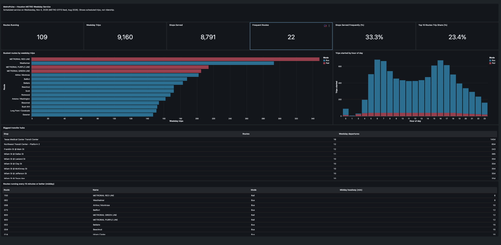
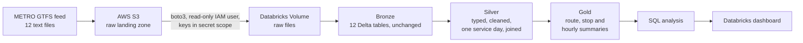

# RouteScope – Houston Transit Data Pipeline

A cloud data pipeline that takes Houston METRO's published bus and rail schedule (GTFS), lands it in AWS S3, cleans and models it in Databricks with PySpark using a bronze/silver/gold (medallion) design, and answers service questions with SQL and a Databricks dashboard.

The analysis covers **scheduled weekday service on Wednesday, November 4, 2026**. It measures what METRO plans to run, not ridership or on-time performance.

## Key findings

1. **Only 1 in 3 stops has frequent service.** Of the 8,791 stops served on a weekday, 2,925 (33.3%) are on at least one route that runs every 15 minutes or better at midday. The other two-thirds are not on any route that runs that often.
2. **Service is concentrated on a few corridors.** The top 10 of 109 routes run 23.4% of all weekday trips. The Red Line leads with 348 trips and a 6-minute midday headway, followed by Westheimer (Route 82), the busiest bus route at 293 trips every 8 minutes.
3. **Bus service follows the commute; rail does not.** Bus trips peak at 6 AM and 4 PM and drop by about 40% at midday. Rail runs a steady ~40 trips per hour from 5 AM to 6 PM.
4. **Texas Medical Center Transit Center is the network's main hub.** It is served by 16 routes with 1,454 scheduled weekday departures, more than double any other stop. Downtown's Milam Street stops form the next tier, each served by 10 or more routes.

What this could mean for planning: because frequent service reaches a minority of stops, raising frequency on a few long routes that are not yet frequent (Langley–Little York and Telephone/Heights each serve 275+ stops) could extend frequent coverage more than adding trips to corridors that already have it.

## Architecture

## Tech stack

AWS S3, AWS IAM, Databricks (Unity Catalog, Volumes, secret scopes, serverless compute, AI/BI dashboards), PySpark, Spark SQL, Delta Lake, Python (boto3), Databricks CLI.

## Data

- **Source:** Houston METRO GTFS static feed, via the Mobility Database
- **Version:** `August2026IVOMS_20260828`, valid Aug 30, 2026 to Jan 23, 2027
- **Size:** 12 files; the largest, `stop_times.txt`, has 1,415,650 rows
- Raw files are not included in this repo. See [data/README.md](data/README.md).

## Pipeline

| Notebook | What it does |
|---|---|
| `01_ingest` | Reads AWS keys from a Databricks secret scope, lists the S3 bucket, and copies each file into a Unity Catalog Volume |
| `02_bronze` | Loads each file into a Delta table with every column kept as text, plus `_source_file` and `_ingested_at` lineage columns |
| `03_explore` | Profiles the data: missing values, duplicate keys, broken references, service patterns, times past midnight, coordinate ranges |
| `04_silver` | Assigns types, converts GTFS times to seconds after midnight, filters to the services active on the chosen date, and joins routes, trips, stops and stop times |
| `05_gold` | Builds route, stop and hourly summary tables, including median midday headway per route |
| `06_analysis` | SQL queries behind each finding and dashboard chart (also in [sql/analysis.sql](sql/analysis.sql)) |

### Row-count reconciliation

| Table | Rows |
|---|---|
| bronze_trips | 21,878 |
| silver_trips (Nov 4, 2026) | 9,160 |
| bronze_stop_times | 1,415,650 |
| silver_stop_times (Nov 4, 2026) | 541,660 |
| silver_stop_events (joined) | 541,660 |

Silver and gold notebooks end with `assert` checks that fail the run if rows are lost in joins, if any time fails to convert, or if gold trip totals stop matching silver.

## Data quality notes

Profiling before cleaning found:

- 0 missing values in key columns, 0 duplicate keys, and 0 broken references between tables
- **58% of trips are weekend trips.** Trips for weekday (service 6), Saturday (4) and Sunday (5) schedules sit in the same table, so counting without a service-day filter would combine three different schedules.
- **32,653 stop times are after midnight** (hours up to 26). GTFS writes a 12:40 AM arrival on a late-night trip as `24:40:00`, so times are stored as seconds after midnight instead of timestamps.
- Times in the raw file have a leading space (`" 4:30:00"`) and are trimmed before conversion.
- `parent_station` is empty for every stop, so hubs are measured per stop rather than per station.
- All stop coordinates fall inside the Houston area.

The service day is chosen with the GTFS calendar rules in code (regular weekday service, plus added dates, minus removed dates), so the pipeline can be pointed at any date in the feed.

## A bug worth noting

The first version of the ingest step used `boto3`'s `download_file()` to write directly into the Databricks Volume. It failed with `OSError: [Errno 5] Input/output error`. `download_file()` speeds up large files by downloading parts in parallel and writing them out of order, and Volumes (a FUSE mount over cloud storage) only support sequential writes. Streaming each object with `get_object()` and writing it in 8 MB chunks, in order, fixed it.

## Limitations

**What the data measures**

- **Scheduled service, not actual service.** GTFS static data is METRO's published plan. It says nothing about ridership, crowding, delays, cancellations or where vehicles actually are. A route can be scheduled every 10 minutes and still run late or bunched in practice.
- **Trips, not capacity.** A rail trip and a bus trip each count as one trip, even though a train carries far more people. Trip counts also ignore route length, so a short downtown route and a 100-minute crosstown route count the same per trip.
- **On-demand services are not included.** 11 of METRO's 120 routes have no fixed weekday schedule in this feed: the six curb2curb zones and the five Community Connector services. These are booked or flexible services, so the pipeline covers the 109 fixed-route bus and rail lines only.

**How the analysis is scoped**

- **One service day.** The analysis uses Wednesday, November 4, 2026. In this feed every regular weekday runs the same schedule (service 6), so the results hold for any normal Monday–Friday, but holidays and Saturday/Sunday service are not analyzed. Weekend trips make up 58% of all trips in the feed and would tell a different story.
- **One feed version.** The results describe the schedule valid from Aug 30, 2026 to Jan 23, 2027. METRO revises its schedules several times a year, so numbers like trip counts and headways will change with the next feed. The pipeline can be rerun on a new feed, but the findings here are a snapshot.

**How the metrics are defined**

- **Headway is measured at the start of each trip.** It is the median gap between trip start times from 10 AM to 2 PM, for each direction, and the route keeps the less frequent of its two directions. This is a conservative choice, but it has blind spots: routes with branches or short trips that serve only part of the line can look more frequent than they are at the far ends of the route.
- **Frequent service is a single-route measure.** A stop counts as having frequent service only if at least one route serving it runs every 15 minutes or better. This can miss stops where several less frequent routes overlap and together arrive more often than every 15 minutes, so the 33.3% figure is likely an undercount of combined frequency at busy corridors.
- **Hours are based on trip start times.** The hourly chart counts a trip in the hour it begins, not the hours it is on the road. A trip that starts at 5:50 AM and runs until 7:30 AM appears only in the 5 AM bar.
- **The 15-minute cutoff matters.** Many routes have a midday headway of exactly 15 minutes, so a 12- or 20-minute threshold would change the count of frequent routes noticeably. 15 minutes is a common planning standard, but it is a choice, not a fact in the data.

**Stops and hubs**

- **Hubs are measured per stop ID, not per station.** The feed leaves `parent_station` empty, so stops that belong to the same transit center are counted separately. Northwest Transit Center is split into two platforms, and Texas Medical Center and Downtown Transit Center each have three stop IDs. Large multi-platform centers are therefore underrated in the hub ranking.
- **Stops are not people.** "One in three stops" is not the same as "one in three residents." Stops in dense areas serve far more people than stops in low-density areas, and the analysis does not account for population, jobs or walking distance.

## Future work

- Add METRO's real-time GTFS feed to compare scheduled and actual arrivals
- Join stop locations to Census tracts to estimate how many residents live near frequent service
- Schedule the notebooks as a Databricks job that reloads each new feed version

## Reproducing

1. Download the METRO GTFS feed (see [data/README.md](data/README.md)) and upload the `.txt` files to `s3://<bucket>/raw/gtfs/`.
2. Create an IAM user with `s3:ListBucket` and `s3:GetObject` on that bucket only, and an access key for it.
3. Store the key in a Databricks secret scope named `metropulse` (keys `aws-access-key-id` and `aws-secret-access-key`).
4. Run the notebooks in order, `01_ingest` through `06_analysis`.
